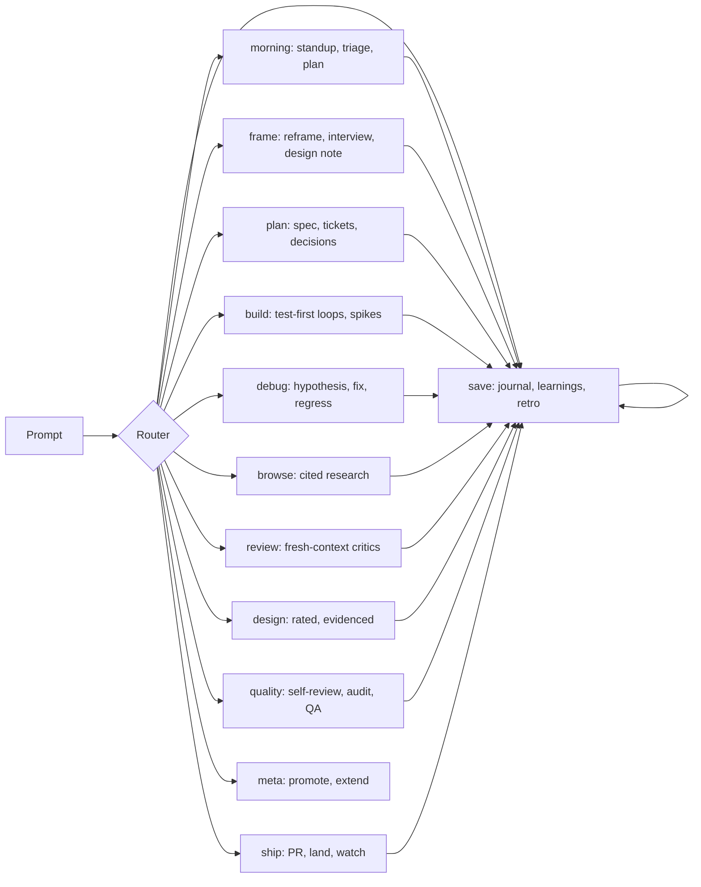

# ferret

Ferret is your dedicated dev-day companion. It routes each task to its
workflow on its own. It saves everything it learns.

<p align="center">
  <strong title="English" aria-label="English">🇬🇧</strong> ·
  <a href=".github/readme/README.zh-CN.md" title="简体中文" aria-label="简体中文">🇨🇳</a> ·
  <a href=".github/readme/README.es.md" title="Español" aria-label="Español">🇪🇸</a> ·
  <a href=".github/readme/README.pt-BR.md" title="Português (Brasil)" aria-label="Português (Brasil)">🇧🇷</a> ·
  <a href=".github/readme/README.ja.md" title="日本語" aria-label="日本語">🇯🇵</a> ·
  <a href=".github/readme/README.vi.md" title="Tiếng Việt" aria-label="Tiếng Việt">🇻🇳</a> ·
  <a href=".github/readme/README.ko.md" title="한국어" aria-label="한국어">🇰🇷</a> ·
  <a href=".github/readme/README.fa.md" title="فارسی" aria-label="فارسی">🇮🇷</a> ·
  <a href=".github/readme/README.th.md" title="ภาษาไทย" aria-label="ภาษาไทย">🇹🇭</a> ·
  <a href=".github/readme/README.ar.md" title="العربية" aria-label="العربية">🇸🇦</a> ·
  <a href=".github/readme/README.fr.md" title="Français" aria-label="Français">🇫🇷</a>
</p>

> English is canonical. Translated guides track the install commands. Their
> prose may lag the 1.0 release.

## Purpose

You describe the work. Ferret classifies it, names its mode in one line, and
runs that workflow. Example mode line:

```text
Mode: review — PR diff needs critics
```

Each reply stays action-first: the next action comes first, ferret numbers
the steps, restates the state, and ends with one concrete next step. Say
`normal mode` to suspend ferret for the session.

## How it works



One install brings the whole companion. There is no per-workflow setup.
The router reads one section file per task and runs it. The save phase
records the journal entry, the insight, or the handoff.

## Install

Paste this into your CLI prompt:

```text
Install the ferret skill/plugin from https://github.com/banavasi/ferret, refer to the repo's AGENTS.md for instructions.
```

Or read [INSTALL.md](INSTALL.md) for per-runtime steps.

## Layout

- `skills/ferret/SKILL.md` — the router. Read it first.
- `skills/ferret/sections/` — one file per day phase. Ferret loads one per task.
- `hooks/` — opt-in always-on injection plus the per-turn router hint.

Say `set up this project` once per repo. Ferret creates the gitignored
`.ferret/` channel: inbox, handoff, learnings, and config.

## Limits and known problems

- Translated guides track commands only. Their prose lags the 1.0 release.
- Second-model critics need a second model CLI on the machine. With one
  model, critics use fresh contexts on the same model.
- The security step is a checklist pass, not a full audit.

## License

[MIT](LICENSE). Derivation credits: [NOTICE](NOTICE.md).
