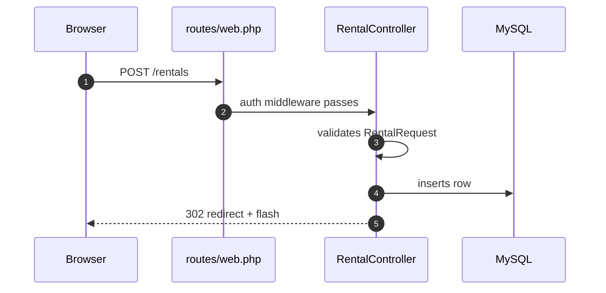

# Diagram

The user is a visual thinker. Draw the real mechanism, not a decorative box chart.

## 1. Pick the output by where it will live

| Need | Tool | Why |
|---|---|---|
| Understand something now, explore, explain AI-written code | **HTML Artifact** with inline SVG (load the `artifact-diagramming` skill, then the `Artifact` tool) | Richest visuals: color, annotations, layers, click-to-expand. Private link the user can share. |
| Diagram goes in the repo, a README, or a PR | **Mermaid** in a ```` ```mermaid ```` block | GitHub renders it. It diffs in review. It stays next to the code. |
| Whiteboard with the team, rough brainstorm | **FigJam** (`generate_diagram` via the Figma MCP) or Excalidraw (MCP needs auth first) | Others can edit it live. |

If unsure, default to the Artifact for understanding, then offer a Mermaid version for the repo.

## 2. Pick the diagram type by the question

| Question | Type |
|---|---|
| "What happens when X?" (request, job, event) | Sequence diagram |
| "What decides the path?" | Flowchart |
| "What are the parts and who talks to whom?" | Component / C4 container diagram |
| "What does the data look like?" | ER diagram |
| "What states can this be in?" | State diagram |
| "Why did it fail?" | Failure chain: trigger -> each step -> the break (red) -> symptom |
| "What did this PR change?" | Before / after, side by side, changes highlighted |

## 3. Rules for a diagram that teaches

- **Read the code first.** Every box and arrow must map to a real file, class, route, table, or service. Put the file path in the label or a legend when it helps.
- **One question per diagram.** If it needs more than ~12 nodes, split it into an overview and zoom-ins.
- **Label every arrow with a verb** ("validates", "writes row", "enqueues job"), not a blank line.
- **Show trust boundaries** (browser / server / database / third party) as grouped regions. That is where security bugs live.
- **Use color for meaning only:** one accent for "changed / the thing we are talking about", red for "fails / risk". Everything else neutral.
- **Number the steps** in flows so the text can refer to "step 4".
- **Under the diagram, write max 5 bullets:** the non-obvious things. Do not narrate the boxes again.
- If part of the flow is a guess (not verified in code), draw it dashed and say so.

## 4. Mermaid quick reference (Laravel example)



Check that the Mermaid parses: keep node IDs alphanumeric, quote labels that contain `()`, `:` or `/`.
